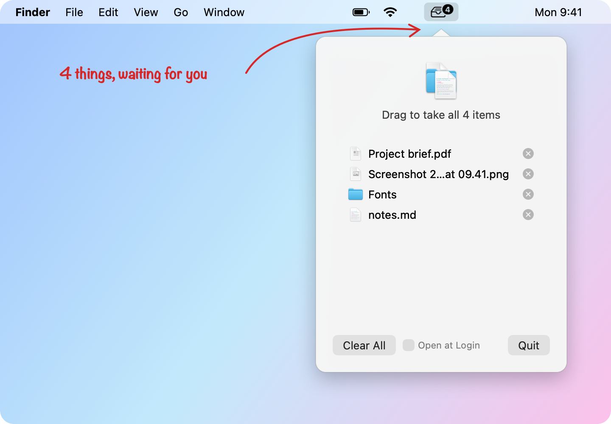

<h1 align="center">🗂️ indieshelf</h1>

<p align="center">
  <em>a tiny drag-and-drop shelf that lives in your Mac's menu bar.<br>
  shake. drop. go do your thing. come back for it later.</em>
</p>

<p align="center">
  <a href="https://github.com/tetzgabriel/indieshelf/releases/latest"><b>⬇ download for Mac</b></a>
  &nbsp;·&nbsp;
  <a href="#build-it-yourself">build it yourself</a>
  &nbsp;·&nbsp;
  <a href="https://meoriente.com.br/indiethings/">part of indiethings</a>
  &nbsp;·&nbsp;
  MIT, free forever
</p>

<p align="center">
  <picture>
    <source media="(prefers-color-scheme: dark)" srcset="docs/hero-dark.png">
    
  </picture>
</p>

---

## The trick

You know the dance. You're dragging a file and the folder you want is buried under six windows, or sits on
another desktop, or is somewhere you haven't even opened yet. So you let go, juggle windows, and start over.

**Don't let go. Shake it.**

```
   1. grab some files          2. shake the cursor          3. a shelf drops down
                                                            ┌─────────────────┐
      ▤ ▤ ───▶ ↖                  ↖ ↗ ↖ ↗ ↖ ↗               │ ▤ report.pdf    │
                                (like you mean it)          │ ▤ photo.jpg     │
                                                            └─────────────────┘
   4. drop them on it.   5. go wherever you need.   6. drag them back out. done.
```

The files wait on the shelf, in your menu bar, for as long as you like. A little tag on the icon tells you how
many are there:

<p align="center">
  <picture>
    <source media="(prefers-color-scheme: dark)" srcset="docs/tags-dark.png">
    
  </picture>
</p>

## What it does

- [x] **Shake to open.** Drag files, wiggle the cursor, and the shelf appears. No hotkey to remember.
- [x] **Lives in the menu bar.** Click the tray icon any time to see what's on the shelf.
- [x] **Keeps things until you say so.** Through restarts too. Removing an item never touches the file itself.
- [x] **Follows your files.** Moved or renamed one? The shelf still knows where it is. Put one in the Trash and
      it quietly leaves the shelf.
- [x] **Doesn't panic about unplugged drives.** Files on an external disk hide while it's away and come back when
      you plug it in.
- [x] **Plays nice with full screen and Mission Control.** No menu bar in sight? The shelf opens right at your
      cursor instead.
- [x] **Looks like it came with your Mac.** Default macOS look, light and dark mode. No themes, no settings, no
      onboarding.

## Lighter than a photo of your cat

The [indiethings](https://meoriente.com.br/indiethings/) rule is "if it's heavier than a photo of your cat, it's
too heavy". Measured on a real Mac:

| | |
|---|---|
| 📦 app size | **770 KB**, and half of that is the icon (the download is 460 KB) |
| 🧠 memory at rest | **about 10 MB** |
| 🔋 CPU at rest | **0.0%**. It only watches the mouse while you hold a button down |
| 📄 code | **one Swift file**, about 670 lines, AppKit only (plus a tiny one that draws the icon) |
| 🧩 dependencies | **zero** |
| 📡 network | **none**. No update checker, no analytics, no "telemetry". Read the source, it's one file |
| 💻 runs on | Apple Silicon and Intel, macOS 14 Sonoma or newer |

## Install

### The quick way: one line in Terminal

Open **Terminal**, paste this, press Return:

```sh
curl -fsSL https://github.com/tetzgabriel/indieshelf/releases/latest/download/indieshelf.zip -o /tmp/indieshelf.zip && ditto -xk /tmp/indieshelf.zip /Applications && open /Applications/indieshelf.app
```

It downloads the latest release, puts `indieshelf.app` in **Applications** and opens it. A tray icon shows up in
your menu bar. That's it, you're in. Run the same line again any time to update (quit indieshelf first).

> **Why Terminal?** When a *browser* downloads an app, macOS marks it "from the internet" and refuses to open it
> unless the developer pays Apple $99 a year to sign it. indieshelf is free, so it isn't. `curl` doesn't add that
> mark, so there's nothing to click through.

### The clicky way: download it

1. Grab **`indieshelf.zip`** from the [latest release](https://github.com/tetzgabriel/indieshelf/releases/latest)
   and double-click to unzip.
2. Drag **`indieshelf.app`** into **Applications** and open it.
3. macOS will say it **"could not verify"** the app. That's the mark from above. Click **Done**.
4. Open **System Settings → Privacy & Security**, scroll down to the line about indieshelf, and click
   **Open Anyway**. You only do this once.

Already downloaded it and got the warning? This removes the mark:

```sh
xattr -dr com.apple.quarantine /Applications/indieshelf.app
```

### Build it yourself

Don't trust a random download? Good instinct. Read [`main.swift`](main.swift), then build it in about a
minute, with nothing but Apple's free command line tools:

```sh
xcode-select --install          # skip if you already have them
git clone https://github.com/tetzgabriel/indieshelf.git
cd indieshelf
./build.sh                      # makes indieshelf.app, for Apple Silicon and Intel
mv indieshelf.app /Applications/ && open /Applications/indieshelf.app
```

macOS doesn't complain about apps you built yourself.

**Start at login:** System Settings → General → Login Items → **+** → indieshelf.

## Cheat sheet

| you | indieshelf |
|---|---|
| drag files and shake | opens the shelf (at your cursor if the menu bar is hidden) |
| drop files on the shelf, or on the tray icon | keeps them |
| click the tray icon | shows the shelf |
| drag files out of the list | hands them over, like a normal Finder drag (⌥ to copy) |
| drag the big icon at the top | hands over **everything** at once |
| double-click a file | opens it |
| click the ⓧ next to a file | takes it off the shelf (the file stays put) |
| right-click | Open, Show in Finder, Remove from Shelf |
| select + Delete | takes the selected files off the shelf |
| Clear All | empties the shelf and closes it |
| Esc, or click anywhere else | closes the shelf |

## How it works, for the curious

- **The shake** is plain geometry: while you hold the mouse button, indieshelf checks the cursor 60 times a
  second and counts quick left-right reversals. Three of them within 0.7 s while dragging files is a shake.
  Dragging text or a link is ignored. No Accessibility permission needed.
- **The memory** of what's on your shelf is a list of macOS *bookmarks*: small references that keep finding a file
  after it's moved or renamed. Nothing is ever copied.
- **The shelf** is a standard macOS popover. It hangs from an invisible point under the icon (or at your cursor),
  so it stays put even when a full-screen app hides the menu bar mid-animation.

## Shake not working?

Run it from Terminal with logging on:

```sh
INDIESHELF_DEBUG=1 /Applications/indieshelf.app/Contents/MacOS/indieshelf
```

Drag a file and shake. You should see `reversal 1`, `reversal 2`, … and then `shake`. If you get
`shake ignored: not dragging files`, the shake was fine but macOS didn't report a file drag. If it's just not
sensitive enough for your taste, the thresholds are the first three lines of `ShakeDetector` in
[`main.swift`](main.swift).

## Uninstall

Quit it (tray icon → **Quit**) and drag `indieshelf.app` to the Trash. The only other trace is
`~/Library/Preferences/io.github.tetzgabriel.indieshelf.plist`, the list of what was on your shelf. Delete it too
for a clean slate.

## Making a release

```sh
./build.sh
ditto -c -k --keepParent indieshelf.app indieshelf.zip   # keeps the app's signature intact
```

Then attach `indieshelf.zip` to a new [GitHub release](https://github.com/tetzgabriel/indieshelf/releases/new).

---

<p align="center">
  <sub>
    part of <a href="https://meoriente.com.br/indiethings/"><b>indiethings</b></a>, a notebook of small, free, weird stuff.<br>
    no ads. no tracking. no accounts. just things.<br>
    MIT licensed. take it, fork it, make it weirder.
  </sub>
</p>
